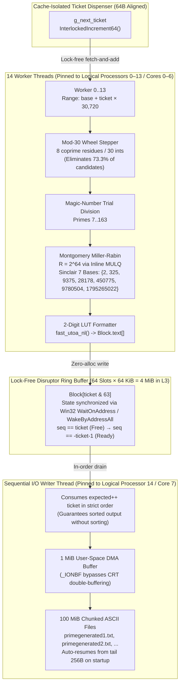

# High-Performance Lock-Free Prime Stream Generator (Zen 4 / Windows x64)

A multi-threaded, lock-free 64-bit prime number generator written in C and engineered for AMD Zen 4 processors (tested on Ryzen 7 7840HS) on Windows x64. Combines **Mod-30 wheel factorization**, **Montgomery multiplication ($R = 2^{64}$)**, **deterministic 7-base Miller-Rabin testing**, and a **64-slot `WaitOnAddress` ring buffer** to stream sorted ASCII primes to NVMe storage at **>120 MB/s** with $O(1)$ memory overhead.

[](LICENSE)
[]()
[]()

---

## 🏗 System Architecture



---

## 🧠 Architectural Trade-Off: Why Stateless Montgomery Miller-Rabin Instead of a Segmented Sieve?

When designing a prime generator, the primary algorithmic choice is between a **Segmented Sieve of Eratosthenes** and **Stateless Deterministic Primality Testing**:

1. **Random-Access Resume Anywhere in $[2, 2^{64}-1]$:** A segmented sieve requires precomputing and storing all primes up to $\sqrt{N}$ (at $N = 2^{64}-1$, $\sqrt{N} = 2^{32}$, requiring ~203 million primes and heavy initialization before emitting a single number). This generator is **100% stateless**: by inspecting the last 256 bytes of the latest output file on startup, it aligns to the Mod-30 wheel and resumes immediately at any 64-bit offset in $O(1)$ time and $4.1\text{ MiB}$ total RAM.
2. **I/O-Bound Regime Saturation:** Because the target workload formats and streams primes to disk as newline-delimited ASCII, sequential NVMe write bandwidth (~120+ MB/s) and integer-to-ASCII serialization become the primary bottlenecks. Combining a Mod-30 wheel, constant-modulo trial division (`7..163`), and Montgomery Miller-Rabin saturates 120+ MB/s of formatted disk throughput in the early-to-mid 64-bit range while keeping the working set entirely inside L1/L2 cache per core.

---

## 🚀 Key Engineering Highlights

### 1. Arithmetic & Microarchitectural Optimizations
* **Montgomery Reduction ($R = 2^{64}$):** Replaces 64-bit hardware division (`DIVQ`, ~20–40 cycles on Zen 4) during modular exponentiation with 64×64→128-bit multiplies (inline `MULQ` on `clang-cl`, `_umul128` / `_umulh` on MSVC) executing at 2/cycle throughput on Zen 4.
* **Zero Compiler-RT Overhead:** Custom inline assembly (`my_umul128`, `my_umulh`, `my_udiv128_rem`) prevents `clang-cl` on Windows from emitting slow software fallback calls (`__umodti3`).
* **Quadratic Newton-Raphson Modular Inverse:** Computes $-n^{-1} \bmod 2^{64}$ in 4 unrolled register multiplications (`inv *= 2 - n * inv`).
* **Deterministic 64-Bit Miller-Rabin:** Uses Jim Sinclair's minimal 7-base witness set (`{2, 325, 9375, 28178, 450775, 9780504, 1795265022}`), proven 100% deterministic for all $n < 2^{64}$.
* **Pre-MR Composite Filtering:**
  * **Mod-30 Wheel:** Steps only through coprime residues $\{1, 7, 11, 13, 17, 19, 23, 29\} \pmod{30}$, skipping $73.3\%$ of integers (all multiples of 2, 3, and 5).
  * **Constant-Modulo Trial Division (`7..163`):** Filters out $>90\%$ of remaining composites using compiler-generated magic-number multiplications before entering Montgomery setup.
  * **Conditional Base Reduction:** Avoids hardware `DIV` instructions when mapping Sinclair bases into the Montgomery domain whenever $n > \text{base}_i$.

### 2. Lock-Free Concurrency & SMT Topology Tuning
* **64-Slot Disruptor Ring Buffer:** Each `Block` is `64 KiB` and 64-byte cache-line aligned (`4 MiB` total ring footprint, fitting comfortably inside the Ryzen 7 7840HS's `16 MiB` L3 cache).
* **Constant-Wheel-Phase Ticket Sizing:** Each ticket spans `BLOCK_SIZE = 30,720` integers (`1024 × 30`). Because $30,720 \bmod 30 = 0$, every ticket begins at the exact same mod-30 wheel index as `g_base_candidate`, eliminating per-block division/modulo alignment.
* **Kernel-Assisted Futex Synchronization (`WaitOnAddress`):** Threads sleep with 0% CPU utilization when waiting on ring slots instead of burning thermal headroom and L3 interconnect bandwidth in spin-loops.
* **False-Sharing Elimination:** Hot atomic variables (`g_next_ticket`, `g_stop`) and read-only globals are isolated on separate 64-byte cache lines (`__declspec(align(64))`).
* **Zen 4 SMT Thread Affinity:**
  * **Logical Processors 0–13 (Physical Cores 0–6):** Pin the 14 worker threads (`THREAD_PRIORITY_NORMAL`).
  * **Logical Processor 14 (Physical Core 7, Thread 0):** Pins the single I/O writer thread (`THREAD_PRIORITY_HIGHEST`), preventing producer-consumer priority inversion.
  * **Logical Processor 15 (Physical Core 7, Thread 1):** Left unpinned for OS scheduling and NVMe driver interrupts.

### 3. Zero-Allocation Formatting & Streaming I/O
* **2-Digit LUT ASCII Serializer (`fast_utoa_nl`):** Converts 64-bit primes two base-10 digits at a time via a 200-byte lookup table (`"00".."99"`) directly into the ring slot buffer—zero heap allocations, zero `sprintf` overhead.
* **Uncached CRT Bypass:** Batches completed 64 KiB blocks into a `1 MiB` user-space buffer (`g_out_buf`) with `setvbuf(..., _IONBF, 0)`, writing directly to `100 MiB` chunked files (`primegenerated1.txt`, `primegenerated2.txt`, ...).

---

## 📊 Performance Benchmarks

**Test System:** AMD Ryzen 7 7840HS (8C/16T, Zen 4), 32 GB DDR5-5600, Windows 11 x64  
**Toolchain:** LLVM `clang-cl` (`/O2 /arch:AVX2 -fuse-ld=link`) via Visual Studio x64 Developer Environment

| Workload / Metric | Measured Result |
| :--- | :--- |
| **Initial 10-Second Burst ($N \le 2.34 \times 10^9$)** | **113,814,454 primes generated (1.20 GB across 12 files in 10.0 s)** |
| **Sustained Throughput ($N \le 2.34 \times 10^9$)** | **11.38M primes/sec** (`~122.8 MB/s` formatted ASCII disk write) |
| **Single-Threaded Python Baseline** | 22.3k primes/sec (`1.34M primes/min`) |
| **Speedup Over Baseline** | **~510x** |
| **Memory Footprint** | **4.1 MiB** static allocation (zero dynamic heap allocations) |
| **CPU Utilization** | 95–98% across 14 worker threads; <2% on writer thread |

> **Note on Asymptotic Scaling:** Prime density decreases logarithmically as $\approx \frac{1}{\ln N}$, and Montgomery modular exponentiation scales as $O(\log_2 N)$ multiplications per Miller-Rabin base. Consequently, throughput transitions from I/O-bound (>120 MB/s) in the 32-bit range to compute-bound as $N \to 2^{64}-1$.

---

## 🛠 Build & Run Instructions (Windows x64 PowerShell)

Because this project uses Windows-specific synchronization APIs (`WaitOnAddress`, `WakeByAddressAll` via `synchronization.lib`) and MSVC linker integration, you must initialize the Visual Studio Developer Environment shell in PowerShell before compiling with `clang-cl`.

### 1. Manual Build & Run (PowerShell)

Run the following commands in a standard Windows PowerShell terminal:

```powershell
# 1. Bypass script execution restrictions for the current PowerShell process
Set-ExecutionPolicy -Scope Process -ExecutionPolicy Bypass -Force

# 2. Launch the Visual Studio x64 Developer Environment to load clang-cl, SDK headers, and link.exe
& "C:\Program Files\Microsoft Visual Studio\18\Community\Common7\Tools\Launch-VsDevShell.ps1" -Arch amd64

# 3. Compile with LLVM clang-cl and link against synchronization.lib
clang-cl /O2 /arch:AVX2 hp_prime_stream_win.c /Fe:hp-primes.exe -fuse-ld=link /link synchronization.lib

# 4. Run the prime stream generator
.\hp-primes.exe
```

### 2. One-Click Build Script 

Alternatively, save the following snippet below as .ps to automate environment initialization and compilation:

```powershell
# scripts/build.ps1
$ErrorActionPreference = "Stop"

Write-Host "Configuring PowerShell Execution Policy for current session..." -ForegroundColor Cyan
Set-ExecutionPolicy -Scope Process -ExecutionPolicy Bypass -Force

Write-Host "Initializing Visual Studio x64 Developer Environment..." -ForegroundColor Cyan
& "C:\Program Files\Microsoft Visual Studio\18\Community\Common7\Tools\Launch-VsDevShell.ps1" -Arch amd64

Write-Host "Compiling hp_prime_stream_win.c with clang-cl..." -ForegroundColor Cyan
clang-cl /O2 /arch:AVX2 hp_prime_stream_win.c /Fe:hp-primes.exe -fuse-ld=link /link synchronization.lib

Write-Host "Build complete! Run .\hp-primes.exe to start generating primes." -ForegroundColor Green
```

### Stopping & Resuming
* Press **`Ctrl+C`** at any time to trigger the console control handler. All active workers finish their current block, the writer flushes pending ring slots in strict ticket order, and the current file closes cleanly.
* Re-running `.\hp-primes.exe` automatically scans the executable directory for the highest-numbered `primegenerated*.txt` file, reads the tail 256 bytes to extract the last committed prime, aligns to the Mod-30 wheel, and resumes generation seamlessly without duplicates or gaps.

---

## ⚠️ Operational Constraints

* **64-Bit Ceiling:** Proven deterministic for all $n \le 2^{64}-1$ (`18,446,744,073,709,551,615`, max 64-bit prime `18,446,744,073,709,551,557`). Workers include an explicit overflow guard and trigger a clean stop when `g_base_candidate + offset` approaches `UINT64_MAX`.
* **Platform & Topology Target:** Uses Windows-specific futex synchronization (`WaitOnAddress`) and thread affinity masks tailored for an 8-core / 16-thread processor (`NUM_WORKERS = 14`, writer on Logical Processor 14).

---

## 📁 Repository Layout

```text
├── hp_prime_stream_win.c    # Single-file lock-free prime stream generator
├── scripts/
│   └── build.ps1            # PowerShell environment bootstrap & clang-cl build script
├── README.md                # Architecture, benchmarks, and build documentation
└── LICENSE                  # MIT License
```

## 📄 License

Released under the [MIT License](LICENSE).

## 👤 Author

**RamnathAK** — Bengaluru, India — Engineered for AMD Ryzen 7 7840HS (Zen 4).
